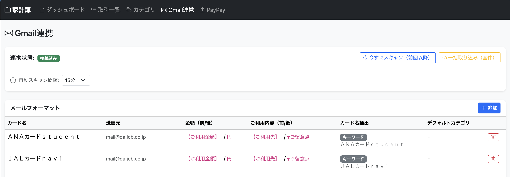
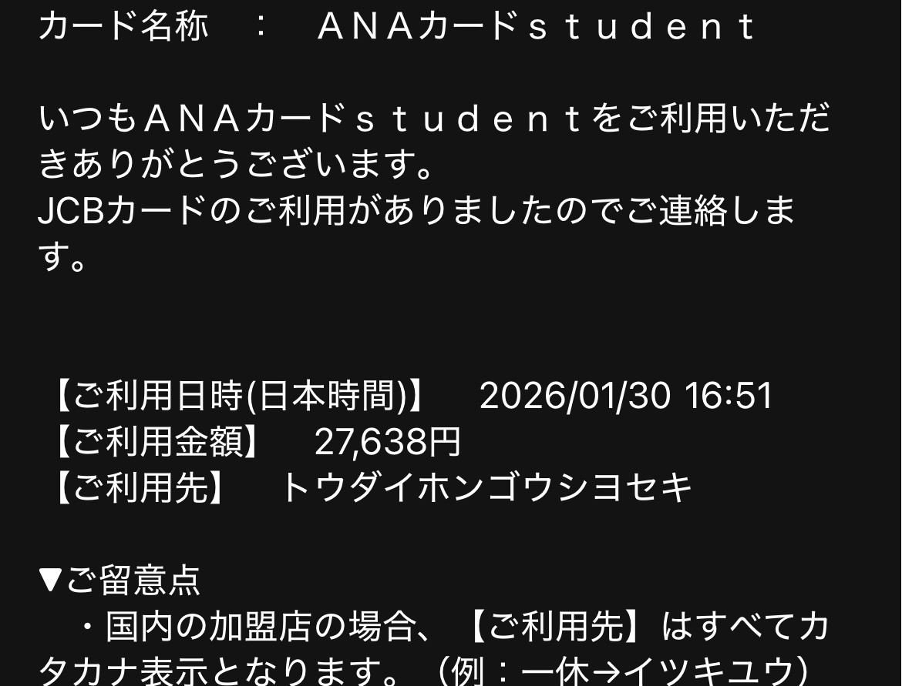
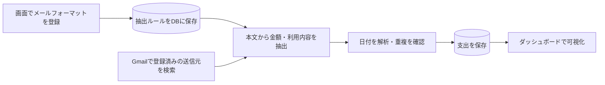

# 利用通知メールから支出を自動記録する家計簿アプリ —

クレジットカード等の利用通知メールをGmailから読み取り、支出を自動で記録するFlask製の家計簿Webアプリです。メールのフォーマットを画面で登録することで、通知形式の異なるサービスにも対応できる仕組みにしています。PayPayの利用履歴のCSV取り込みにも対応しています。標準的な家計簿アプリの機能である収支の可視化等も実装しています。

## 開発背景

このリポジトリを作成した当時、クレジットカード等の利用履歴を無料で自動取り込みできる家計簿アプリがありませんでした。そこで、利用通知メールをデータ源にすれば、支出を一件ずつ入力する手間を減らせると考え、開発しました。

目指したのは、手入力の負担を減らしながら、複数の支払い手段の履歴を一つの家計簿にまとめることです。Gmailからの自動取り込みに加え、PayPayのCSV取り込みと手動入力にも対応しています。

## 一番の工夫：フォーマット登録によるメールの自動スキャン

カード会社やサービスによって、利用通知メールの文面は異なります。その違いに対応するため、送信元アドレスと、金額・利用内容の前後にある文言を「メールフォーマット」としてDBに保存し、共通の抽出処理で利用する設計にしました。

利用者は正規表現を書かずに、画面から抽出ルールを登録できます。対応する文面であれば、サービスごとのパーサーをコードに追加することなく、設定の追加で取り込み対象を増やせます。

### 登録例



以下は説明用のメール本文例です。



| 登録する項目 | 設定例 | 抽出結果 |
| --- | --- | --- |
| 金額の直前 / 直後の文言 | `【ご利用金額】` / `円` | `27,638`|
| 利用内容の直前 / 直後の文言 | `【ご利用先】` / `▼ご留意点` | `トウダイホンゴウシヨセキ` |

登録時はサンプル本文を使って抽出結果をプレビューできます。カード名は前後の文言による抽出、またはキーワード一致で取得でき、フォーマットごとに既定のカテゴリも指定できます。



Gmail連携とフォーマット登録後は、アプリ稼働中に定期スキャンします。間隔は15分・30分・1時間・1日から選択でき、手動の差分スキャンと過去メールの一括取り込みも可能です。

実装： [メールフォーマットモデル](app/models/email_format.py) / [抽出処理](app/services/email_parser.py) / [Gmailスキャン処理](app/services/gmail_service.py)

## 主な機能

| 機能 | 内容 |
| --- | --- |
| Gmail連携 | OAuth 2.0で連携し、登録した送信元の利用通知メールから支出を取り込み |
| メールフォーマット管理 | 金額・利用内容・カード名の抽出ルール、既定カテゴリの登録と抽出プレビュー |
| スキャン状況の確認 | 進捗表示、手動・定期スキャンの履歴、スキップ理由と最新スキャンの詳細確認 |
| PayPay CSV取り込み | 支払い・返金・受け取った金額を取り込み。投資の取り込みは任意で選択 |
| 取引管理 | 収支の手動登録・編集・削除、月・カテゴリ・収支種別・取り込み元での絞り込み |
| カテゴリ管理 | 収入・支出カテゴリの追加・編集・削除、表示色の設定 |
| ダッシュボード | 月の収支・残高、日別カレンダー、カテゴリ別内訳、年間の月別推移を表示 |

## 設計上の工夫

### 差分検索と重複排除を組み合わせた取り込み

差分スキャンでは、直前に正常終了したスキャンの開始時刻から5分戻して検索します。スキャン中に届いたメールなどの取りこぼしを抑えるため、検索範囲に重なりを持たせています。

重なる期間のメールはGmailメッセージIDで重複排除し、DBの`external_id`にも一意制約を設けています。PayPayも取引番号で重複を判定します。取引と取り込み履歴を同じDBトランザクションで確定し、失敗時はロールバックすることで、再実行できる状態を保ちます。

初回の差分スキャンは過去90日、一括取り込みは登録済み送信元の全期間が対象です。取引日にはメールのDateヘッダーの日付を使い、解析できないメールはスキップ理由を記録します。

### バックグラウンド処理と進捗表示

手動スキャンは`threading.Thread`で実行し、画面は進捗APIを1秒ごとに取得します。開始判定と進捗情報をロックで保護し、手動スキャンと定期スキャンが重なった場合も、同じプロセス内では一つだけ実行するようにしています。

### 認証・入力検証・障害時のデータ保護

- Gmail APIは読み取り専用のスコープを使用し、OAuthではPKCEと`state`検証を実装しています。
- 開発・本番ともBasic認証を必須とし、15文字以上のパスワードと認証失敗のレート制限を設けています。
- 更新リクエストにCSRF保護を適用し、入力値はサーバー側で検証します。画面表示にはJinja2の自動エスケープとJavaScriptのHTMLエスケープを使います。
- GmailトークンはDBで管理し、一時的な通信・DB障害では削除しません。Googleが`invalid_grant`として失効を確認した場合に削除します。
- Gmailスキャンの失敗時は、画面に固定メッセージを返します。例外本文やトレースバックをログに出さず、関連ライブラリのログにも秘密情報を伏せる処理を適用しています。

### 起動処理とDB変更の分離

開発・本番の設定を分け、必須設定をDB初期化前に検証します。DBスキーマはAlembicで管理し、アプリ起動時にはテーブル作成やマイグレーションを実行しません。初期カテゴリも専用CLIで不足分だけを追加し、既存カテゴリを維持します。

## 技術構成

| 領域 | 使用技術 |
| --- | --- |
| バックエンド | Python 3.12以上 / Flask |
| DB・マイグレーション | SQLAlchemy / SQLite（ローカル開発）/ PostgreSQL（本番設定）/ Alembic |
| フロントエンド | Jinja2 / Bootstrap 5 / Vanilla JavaScript / Chart.js |
| 外部連携 | Gmail API / Google OAuth 2.0 + PKCE |
| 定期・非同期処理 | APScheduler / threading |
| 認証・CSRF保護 | Basic認証 / Flask-WTF |
| パッケージ管理・テスト | uv / unittest |

画面・HTTP処理を`routes/`、取り込み・解析処理を`services/`、データ定義を`models/`に分けています。

```text
app/
├── __init__.py       # アプリ生成・Blueprint登録・スケジューラ起動
├── config.py         # 環境別設定と起動前の検証
├── commands.py       # 初期カテゴリ登録・旧Gmailトークンの取り込み
├── models/           # 取引・カテゴリ・メールフォーマット・スキャン履歴
├── routes/           # ダッシュボード・取引・カテゴリ・Gmail・PayPay
├── services/         # Gmailスキャン・メール抽出・PayPay CSV解析・認証
├── templates/        # Jinja2テンプレート
└── static/           # 静的ファイル
migrations/          # AlembicによるDBスキーマ管理
tests/               # unittestによる自動テスト
docs/                # README用のスクショ
```

## ローカルでの起動

Python 3.12以上、uv、Gmail APIのOAuthクライアント認証情報が必要です。以下は新規のローカル環境向けの手順です。既存環境では`.env`を上書きせず、`DATABASE_URL`の接続先を維持してください。

### 1. 依存関係のインストール

リポジトリのルートで実行します。

```bash
uv sync --frozen
```

### 2. OAuthと環境変数の設定

Google CloudでGmail APIを有効にし、OAuth同意画面とWebアプリケーション用のOAuthクライアントを設定します。開発用リダイレクトURIに`http://localhost:8080/gmail/oauth/callback`を登録し、取得した認証情報を`credentials.json`としてプロジェクトルートに配置してください。

プロジェクトルートに`.env`を作成し、次の項目を設定します。

| 変数 | ローカル開発での設定 |
| --- | --- |
| `FLASK_SECRET_KEY` | `openssl rand -hex 32`で生成したランダム値。32文字以上 |
| `APP_USERNAME` | Basic認証のユーザー名 |
| `APP_PASSWORD` | 別途`openssl rand -hex 32`で生成した、このアプリ専用のランダム値。15文字以上 |
| `DATABASE_URL` | 新規環境では`sqlite:///household.db`。既存環境は現在の接続先を維持 |
| `GMAIL_REDIRECT_URI` | `http://localhost:8080/gmail/oauth/callback` |
| `CREDENTIALS_FILE` | `credentials.json`。相対パスはプロジェクトルートから解決 |

`.env`とOAuth認証情報はGitにコミットしないでください。`APP_ENV`は`.env`を読み込む前に必要なため、次のコマンドで明示します。

### 3. DB初期化とサーバー起動

```bash
APP_ENV=development uv run alembic upgrade head
APP_ENV=development uv run flask --app app:create_app seed-categories
APP_ENV=development uv run flask --app app:create_app run --debug --port 8080
```

ブラウザで`http://localhost:8080`を開き、設定したBasic認証情報でログインします。Gmail画面からGoogleアカウントを連携し、メールフォーマットを登録するとスキャンできます。

## テスト

```bash
uv run python -m unittest discover -s tests -v
```

テストでは一時DBとダミー認証情報を使い、Google APIをモックします。実際の家計簿DBやGmailアカウントを使わずに、次の挙動を検証します。

- メールの日付解析、差分検索の境界、重複排除、失敗時のロールバック
- 手動・定期スキャンの同時実行制御、スレッド起動失敗後の再実行
- OAuthのPKCE・`state`検証、トークンの保持・移行
- 入力検証、CSVの不正行・重複行、CSRF保護、Basic認証のレート制限
- 設定検証、既存データを維持するマイグレーション、ログの秘密情報保護

## 現在の制約と改善候補

個人利用を想定した単一アカウントの構成です。スケジューラ・スキャン進捗・認証の制限状態はプロセス内で管理するため、worker数・インスタンス数は1で運用します。複数プロセスに対応する場合は、ジョブと状態の共有方法を見直す必要があります。

メールの自動取り込みは、登録した送信元と抽出ルールに合う文面が対象です。通知形式が変わった場合はフォーマットの再登録が必要になります。また、現在の取引日はメールのDateヘッダーに基づくため、実際の利用日と異なる場合があります。

今後の改善候補は、登録済みフォーマットの編集機能と、本文からの利用日抽出です。将来的にはAIエージェントを用いた自動抽出を検討しています。


